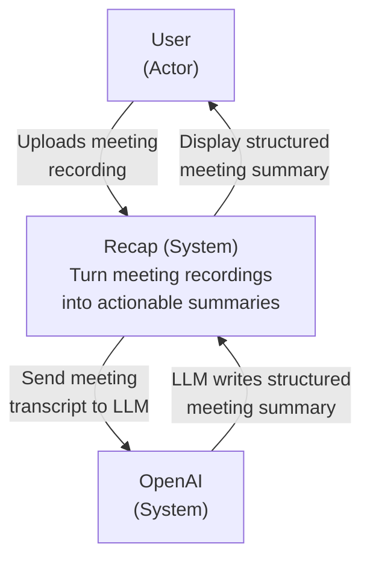
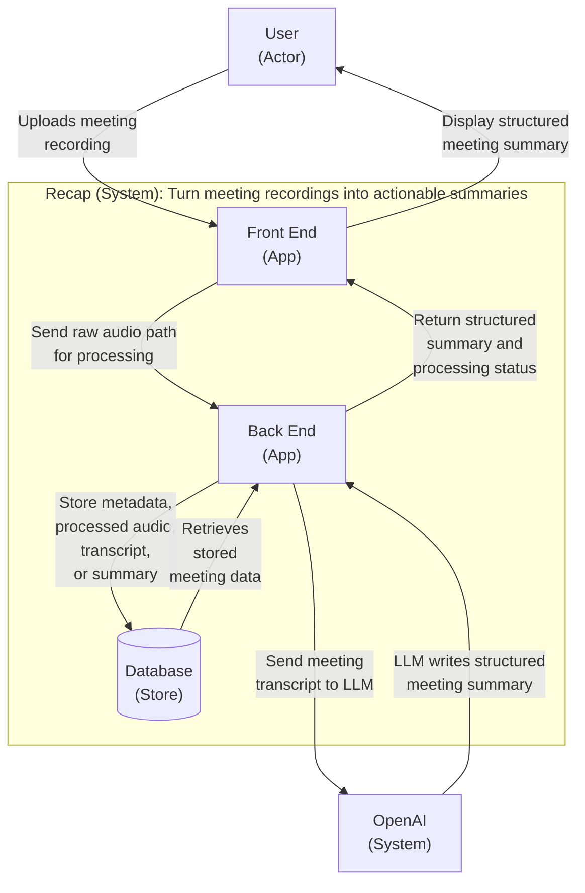
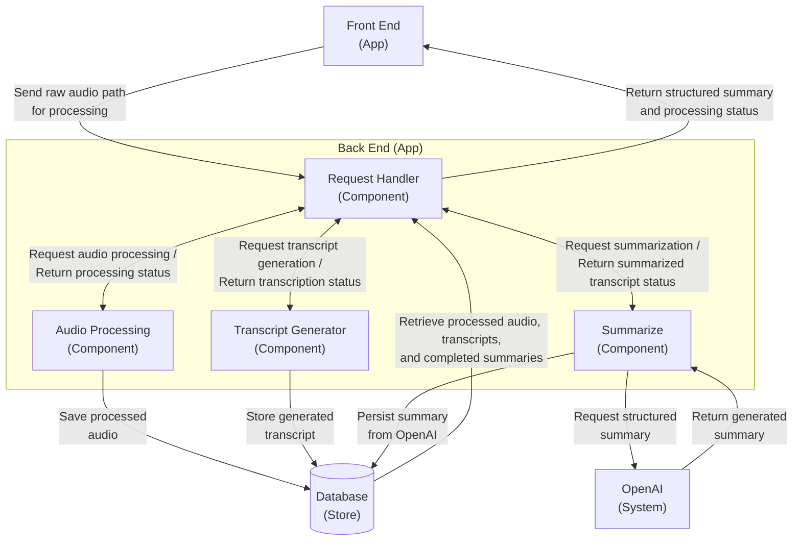
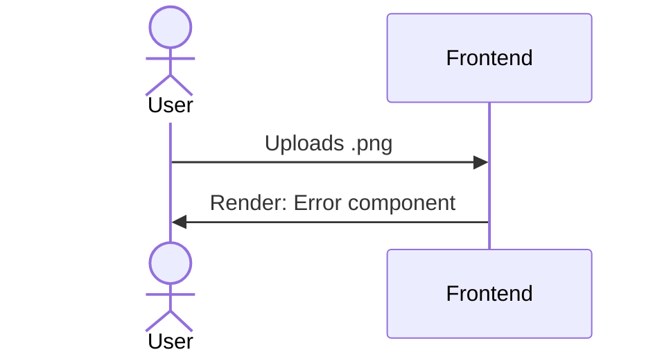
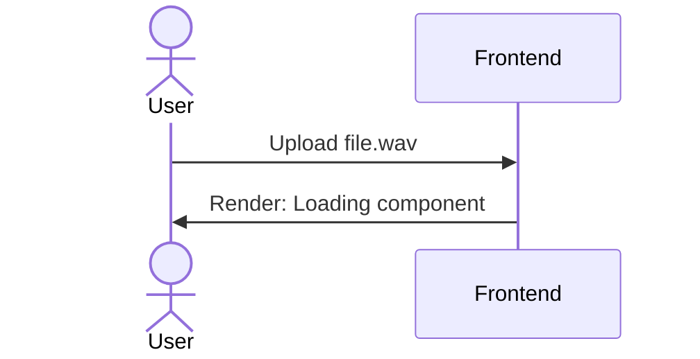
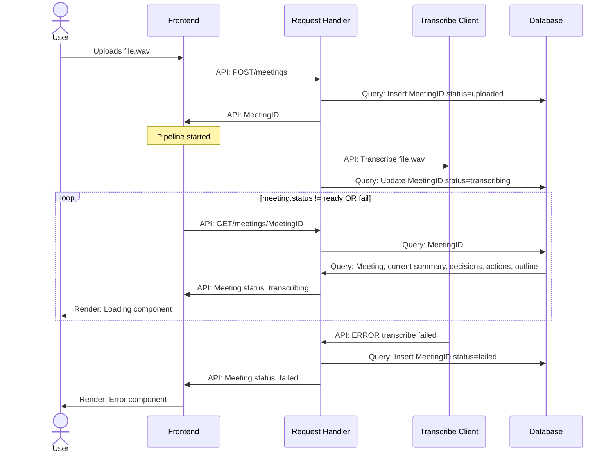
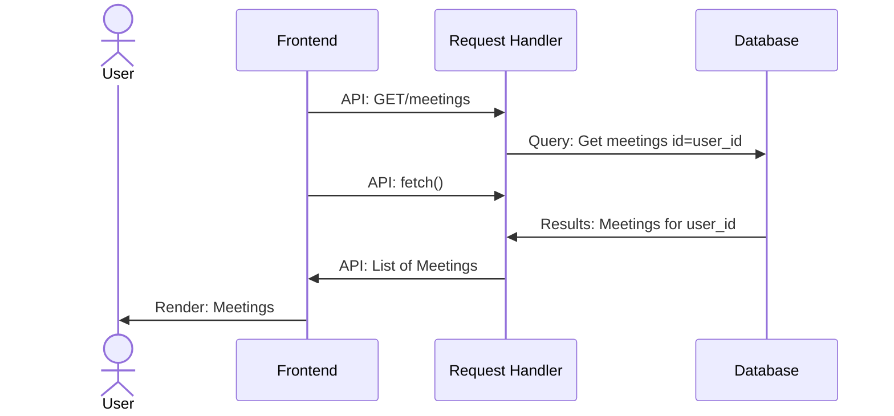
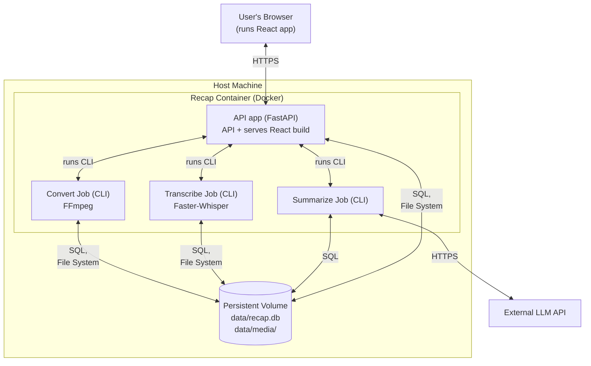

# 

**About arc42**

arc42, the template for documentation of software and system
architecture.

Template Version 9.0-EN. (based upon AsciiDoc version), July 2025

Created, maintained and © by Dr. Peter Hruschka, Dr. Gernot Starke and
contributors. See <https://arc42.org>.

# Introduction and Goals (Keyan)

Recap is a project focused on improving meeting effectiveness and efficiency through AI-powered summarization. It addresses the issues of meetings often going undocumented, manual note taking distracting participants, and important decisions and responsibilities being overlooked. Recap accomplishes this by extracting and organizing the following information from meetings: 

- Short overall summary 
- Key decisions 
- Action items  + owners 
- Topic outline with timestamps 

Once an audio file is uploaded, the system processes the recording, generates a summary, and displays it to the user. Users can export summaries as PDF files or markdowns, to retain and refer back to meeting information over time. Users do not need to create an account or sign in, database entries are associated with the user’s browser through long-lived cookies. 

The system should process audio files reliably and generate accurate and understandable summaries within a reasonable amount of time. Errors should not cause the application to fail, they should be handled gracefully and communicated clearly to the user. The user interface should also be intuitive and provide a seamless experience for users. 

## Requirements Overview (Rita)

### **Contents**

The main purpose of Recap is to provide a structured summary for the user. The system takes an uploaded audio file in mp3, mp4, or WAV format and transcribes it into a summary display to the user. 

### **Main Features**

- Provide simple user interface that is easy to navigate
- Summarize audio file into a structured format
- Summary format contains a short summary section, key decisions, topic outline with timestamps
- User has an option to download a summary into a pdf file or markdowns 
- Handle unexpected file gracefully

### **Motivation**

The system is intended to provide an accurate summary where users can refer back to the meeting information later. 

(not main features)/ detailed requirement table
- After the user upload the audio file, audio file will be deleted
- Display a file upload percentage

### **Form**

TODO

## Quality Goals (Keyan)

Work in progress:

| Quality | Motivation |
|---------|------------|
| Understandability | Information pulled from the audio/video files should not be a wall of text. Extract a short overall summary, key decisions, action items, and a topic outline with timestamps. |
| Reliability | The system does not crash in the face of file or API failure. Errors should be handled gracefully and communicated clearly to Users. |
| Compatibility | Application works for devices of any size, running any operating system linux, mac, or windows. Audio files from anything should be accepted (Zoom, Teams, phone calls, etc. ) |
| Usability | The User interface should be attractive and intuitive for all users. The database should store user's information on a per browser basis, so past recaps can be displayed and re-opened. |
| Interoperability | The Application should provide a simple Rest API that is capable of grabbing users past meetings, posting new meetings, and communicating what stage the pipeline is in. |

## Stakeholders (Charles)

| Role/Name             | Contact       | Expectations                                                                                                                                             |
| --------------------- | ------------- | -------------------------------------------------------------------------------------------------------------------------------------------------------- |
| Meeting Chair/Host    | <Contact>     | Wants reliable meeting notes with fast turnaround time containing relevant action items and key decisions.                                               |
| Meeting Participant   | <Contact>     | Wants to make sure meeting software is compliant with security and privacy policy.                                                                       |
| Development Team      | Recap Discord | Wants the application to work across operating systems, with fast, reliable transcriptions using free LLM tokens through EDU credits or running locally. |
| Capstone Sponsor      | Amanda        | Manages and evaluates the project, including implementation, guidelines, feasibility, and milestones.                                                    |
| Data Privacy Officers | <Contact>     | Wants to make sure meeting software is compliant with security and privacy policy.                                                                       |

# Architecture Constraints (Charles)

### **Technical Constraints**

| Constraint                          | Explanation                                                                                                                    |
| ----------------------------------- | ------------------------------------------------------------------------------------------------------------------------------ |
| FastAPI                             | Backend framework to asynchronously route API requests, manage transcriptions, summarizations, and link to the React frontend. |
| WhisperAPI/FFMpeg                   | Local speech-to-text pipeline used to process audio files and extract accurate transcripts efficiently.                        |
| ResponsesAPI                        | Used to generate meeting summaries, action items, and key decisions.                                                           |
| Database Management System (SQLite) | Relational Database storage used for tracking states, audio files, and meeting metadata                                        |
| Python                              | Language used for backend framework and processing scripts.                                                                    |
| Vite                                | Used for bundling and local development rendering.                                                                             |
| React-router-dom                    | Library used to handle single-page application routing and navigation.                                                         |
| TailwindCSS                         | CSS Framework for styling the application                                                                                      |
| Javascript                          | Language used for React application.                                                                                           |
| React                               | Frontend framework used to build the user interface.                                                                           |
| Docker                              | Containerized platform for execution across different host machines.                                                           |
| Axios                               | Library used to handle single-page application routing and navigation.                                                         |

### **Organizational Constraints**

| Constraint                 | Explanation                                                                             |
| -------------------------- | --------------------------------------------------------------------------------------- |
| Team                       | Charles, Dennis, Keyan, Luke, Nick, Rita                                                |
| Project Time               | Seven-month total project time. Prototype ready in December and a full showcase in May. |
| Budget                     | No money for third-party hosting or APIs. Everything must rely on local compute.        |
| Version Control Management | Git repository with commit history, feature branches, main branches pushed to GitHub.   |

# Context and Scope (Nick)

Recap is a web application that takes a speech recording from the user's browser and transcribes it. It relies on an external LLM to transform that transcription into a concise summary. Recording meetings, hosting meetings, live listening, managing accounts, and acting on the meeting summaries are outside of the scope. Recap is only responsible for processing files provided by the user and a history of previous uploads by said user is provided through returning user's browser cookies.

# Solution Strategy (Dennis)

The application will be a web-based platform that will process audio files using AI to return a transcription and other AI-powered features, while using cookies to keep track of the user’s past transcriptions in a database. Therefore, the structure of the project is three parts that includes the frontend, backend, and database.

React will be used to create the user interface for uploading files and viewing status of file transcription and view past transcriptions. FastAPI will be the backend API to coordinate requests from the frontend. Faster-Whisper is the model of choice to handle speech transcription. Additionally, the backend will also support other AI processing features.

All AI processing will be happening in the background, so that the frontend is not limited and required to wait while it is happening. Progress will be available with an interactive interface which will display the status of the file, which will include status values like “uploading,” “transcribing,” and “ready,” just to name a few.

Once processed, transcriptions and any other generated data will be stored using SQLite, allowing users to return and view any past transcriptions. For security reasons, the file itself will not be stored anywhere, only the resulting generated data. This data will be tracked using long-lived user cookies, so there will be no login required.

# Building Block View (Luke)

## Scope and Context

React provides users with a single interface to upload meeting recordings from their local filesystem and view structured summaries of the audio content. The system interfaces with the OpenAI API to generate the summaries from meeting transcripts. 

### Interfaces
| Interface | Direction | Description |
|---|---|---|
| User Interface | User ↔ Recap | Uploads recordings and displays summaries |
| OpenAI API | Recap ↔ OpenAI | Sends transcripts and receives structured summaries |

## Level 1

### Motivation

We have chosen to separate the primary architectural components of Recap into a Front End, Back End, and a Database. This separation ensures responsibility for the primary functions of Recap are owned by their respective components. This establishes a clear boundary between parts of the system the user will interact with and critical internal system functionality.

### Contained blackboxes
| Building Block | Description |
|---|---|
| Front End | Provide the interface that users will interact with when uploading meeting recordings or viewing structured meeting summaries. |
| Back End| Process recordings, generate transcripts with Whisper, interact with OpenAI API, and manage data transfer between front end and database. |
| Database | Record metadata about meeting recordings, transcripts, and summaries|
---
### Interfaces
| Interface | Direction | Description |
|---|---|---|
| User Interface | User ↔ Front End | Uploads recordings and displays summaries |
| Backend API | Front End ↔ Backend | Send raw audio for processing and return structured summary and processing status | 
| Persistence API | Backend ↔ Database | Manage communication from backend to database |
| OpenAI API | Backend ↔ OpenAI | Sends transcripts and receives structured summaries |
---

## Level 2

### Motivation

Recap's Back End has been split into several independent components that all perform a specific function within the system. The Request Handler coordinates communication between the other functional components and the Front End. This separation of responsibilities allows us to develop, debug, and modify the components largely in isolation and will contribute to the success of this project. These components will communicate with each other through predefined interfaces, allowing changes to the internals of a component to not affect the system as a whole. 

### Contained blackboxes
| Building Block | Description |
|---|---|
| Request Handler | Interpret requests from front end, call corresponding back end modules, access stored meeting data, and return results to front end |
| Audio Processing | Process raw audio files with ffmpeg |
| Transcript Generation | Generate structured transcripts from processed audio files with Faster-Whisper |
| Summarize | Coordinate communication with OpenAI API and generate structured summaries of passed transcripts  |
---

### Interfaces
| Interface | Direction | Description |
|---|---|---|
| Backend API | Front End ↔ Backend  | Receives uploaded audio files and returns structured summaries |
| Audio Processing CLI | Request Handler ↔ Audio Processing | Initiates audio processing and returns completion status |
| Transcription CLI | Request Handler ↔ Transcript Generation | Initiates transcription with Faster-Whisper and returns completion status |
| Summarization CLI | Request Handler ↔ Summarize | Initializes summarization and returns completion status|
| OpenAI API | Summarize ↔ OpenAI | Sends transcripts and receives structured summaries from OpenAI|
| Database Access | Backend Components ↔ Database | Each component individually manages reading and writing to the database. | 

---

# Runtime View (Rita + Keyan 😀)

## 6.1 User Uploads Invalid File 

Invalid Files: Frontend restricts uploaded files types to audio only. 

## 6.2  Upload Valid File  

Valid files: The audio summary is displayed on the frontend. 

## 6.3 Backend API Fails 

This scenario showcases what would happen if one of the backend API’s were to fail. The failure would be logged in the database, and the error message communicated to the user. This would be similar to the Summary Client failing, except the transcription of the meeting would be saved in the database. You can assume the Convert Client succeeded in the following scenario: 

## 6.4 Display all Meetings for user 

## \<Runtime Scenario n\>

# Deployment View (Nick)

## Infrastructure Level 1

### **Motivation**  
We are targeting a complete self-hosted web application. The main priorities are simplicity, portability, and functionality. We are not expecting high traffic which means we can defer the use of container clusters, complex event streams and message/job queues. Furthermore, to maintain simplicity we are utilizing a single Docker container to contain the entirety of the web app host. This has the secondary benefit of giving us portability to run on varying hosts and operating systems. With this infrastructure layout we also maintain the modularity required for a multi-person project. Utilizing a central app for the API and subprocesses for the modular components of Recap gives clear compartmentalization of the application.

### **Quality and/or Performance Features**
- **Responsiveness**: The API and web server relay jobs to the parallel CLI subprocesses. This keeps them free to handle incoming traffic without having to wait for running jobs to complete before serving other users.
- **Persistence and Reliability**: The database and data volume persist across container restarts, rebuilds, and crashes. The downside of running a single Docker container on a single host machine is a single point of failure. If the host goes down, or gets so much traffic that CPU load becomes too high, the application will respond slowly or not at all.
- **Scalability**: This model does not provide scalability on its own. It cannot scale to high traffic that exhausts CPU or GPU load. However, its infrastructure layout could be converted to take advantage of event streams and cluster configurations later with some refactoring.
- **Privacy**: The transcript is the only user data that leaves the host machine; it is sent to the external LLM for the summarize function. Otherwise, user data stays on the host machine. Recap keeps a copy of the user's audio file after FFmpeg conversion, along with the resulting transcription and summary.

### **Mapping of Building Blocks to Infrastructure**
TODO: Waiting on Building Block View

# Quality Requirements (Nick)

## Quality Requirements Overview

## Quality Scenarios

# Risks and Technical Debts (Dennis)

# Glossary (Dennis)

| Term | Definition |
|------|------------|
| Whisper | |
| Faster Whisper | |
| Open AI | |
| Python | |
| UV Packet Manager | |
| Git Hub | |
| Vite | |
| Tailwind | |
| Axios | |
| React-router-dom | |
| Fast API | |
