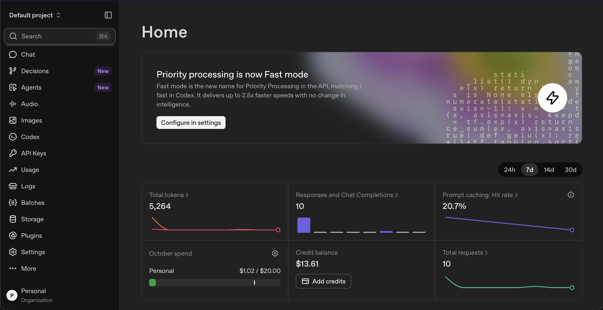
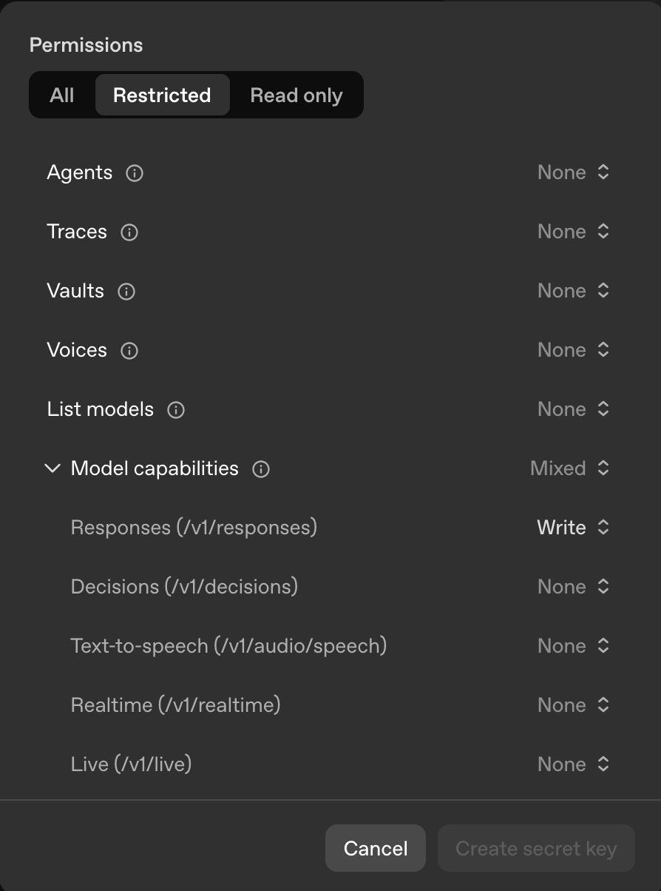

## Getting an OpenAI key and Setting up `.env`

### Overview
Summaries are obtained through the `Summarize` class. The `Summarize.generate()` method takes a transcript as input and uses the `Responses API` from OpenAI to produce a structured meeting summary.


### Get API Key

API Keys are obtained from OpenAI through the [OpenAI Platform](https://platform.openai.com). Your OpenAI Platform account will need to have available credits to run the pipeline. If needed, add credits through the [Billing Settings](https://platform.openai.com/settings/organization/billing/overview) after account creation.


<p align="center">
  
</p>

You will need to create an account if you don't have one already. You can create the key in the default project, or create a new project for the purposes of our development. The left sidebar should have an option to manage your API keys.

Inside of the API window there is an option to **Create New Secret Key**. Your key will be created in this window. I recommend naming your key, selecting the project that it belongs to, and setting some expiration date in the future.

<p align="center">
  
</p>

When creating the API key, select **Restricted** permissions. Enable **Write** for the **Responses API** and leave other permissions set to **None**.

Keep your API key private. The `.env` file is already ignored by Git to help prevent accidentally committing your key.

### Setting up `.env`

From the `back-end/` directory, create a `.env` file with the following command:

```sh
touch .env
```

Then open `.env` and add the following:

```dotenv
OPENAI_API_KEY=your_api_key_here
```

Then replace `your_api_key_here` with your API key. The final path should be `Recap/back-end/.env`.

### Running the summarize demo

`apps/summarize/src/summarize/cli.py` contains the class that we will import into other files and use to run the summarize pipeline. There is a small example meeting contained in the file that will output the summarized meeting to the terminal.

Run the following command from the `back-end/` directory:

```sh
uv run --package summarize --env-file .env summarize
```

Running this example incurs OpenAI API usage charges.

The above command uses UV to load your `.env` file. As we progress through the project we may update the method for loading the environment file. This guide will stay up to date on the methods used for this.
